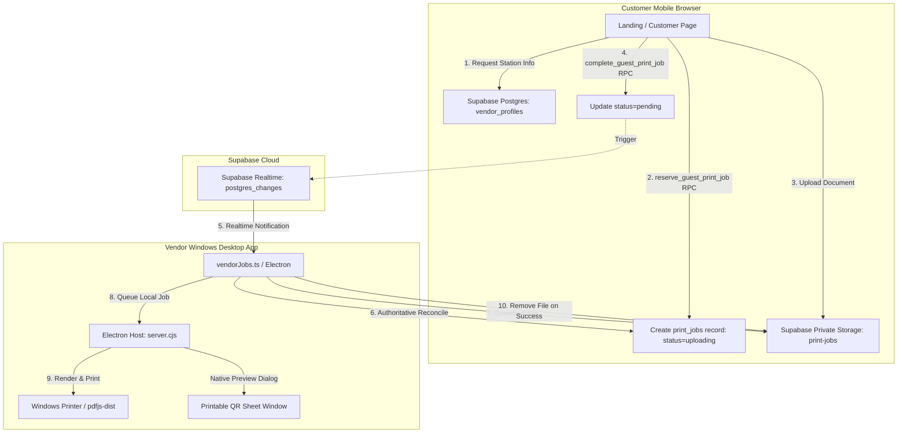

# Architecture

## Overview

QR Print Bridge is architected as a lightweight, serverless bridge between mobile customers and local Windows printers. It comprises a customer-facing web application hosted on Vercel, a vendor desktop Electron application, and Supabase cloud infrastructure.

## System Components

### 1. Guest Web Application (`guest/`)
- **Technology:** React 18, TypeScript, Vite, Tailwind CSS v4.
- **Routing:**
  - `/`: Marketing landing page showcasing the product, benefits, and download links.
  - `/v/<vendor-slug>` or `?slug=<slug>`: Customer upload station showing vendor details (shop name, proprietor, address), promotional offers, file selection, and real-time upload progress.
- **Hosting:** Deployed to Vercel via standard static output (`guest/dist`).

### 2. Vendor Desktop Application (`vendor-desktop/`)
- **Technology:** Electron 33, React 18, TypeScript, Tailwind CSS v4, Express local bridge.
- **Modular Interface:**
  - `AuthScreen`: Sign in and sign up with Supabase Auth.
  - `StationHeader`: Online/offline cloud connection indicators and sign out.
  - `WelcomeBanner`: Shop profile editor allowing vendors to configure shop name, proprietor name, address, and live customer offers.
  - `QrPanel`: Displays live QR code, copyable permanent URL, and "Print QR" poster preview.
  - `SettingsPanel`: Displays active Windows default printer, total/pending/finished metrics, and auto-approval switch.
  - `JobsPanel`: Live list of incoming and processed print jobs with status indicators, timestamps, file sizes, and file previews.
  - `PreviewDialog`: Local file preview modal for verifying documents before printing.
- **Electron Print Integrations:**
  - `pdf-print.html`: Uses `pdfjs-dist` in an offscreen `BrowserWindow` to render PDF pages directly to HTML5 canvas and prints them silently via Electron `webContents.print`.
  - `qr-print.html`: Renders a high-resolution, counter-ready QR code poster in a dedicated window with one-click native printing via Electron `webContents.print`.

### 3. Supabase Cloud Infrastructure
- **Supabase Auth:** Manages vendor accounts, sessions, and secure token refresh.
- **Postgres Database:**
  - `public.vendor_profiles`: Stores vendor UUID, unique public slug, display name, accepting status, and shop details (`prop_name`, `shop_name`, `address`, `offer`).
  - `public.print_jobs`: Stores job UUID, vendor reference, storage path, filename, MIME type, file size, print options, status lifecycle, error messages, and expiration timestamps.
- **Private Storage Bucket (`print-jobs`):**
  - Private bucket restricted to `application/pdf`, `image/jpeg`, and `image/png` up to 25 MB.
  - Scoped object paths: `<vendor_id>/<job_id>/<filename>`.
- **Supabase Realtime:**
  - Broadcasts `postgres_changes` on `public.print_jobs` filtered by `vendor_id`.

## Upload and Print Lifecycle

1. **Station Resolution:** The customer scans the QR code and opens `/v/<vendor-slug>`. The guest client queries `public.vendor_profiles` where `slug = :slug` and `accepting_jobs = true`.
2. **Job Reservation:** The customer selects a document (PDF, PNG, JPG ≤ 25 MB). The browser calls the `reserve_guest_print_job` RPC, creating a job record with `status = 'uploading'` and generating a cryptographically unique storage path.
3. **Encrypted Storage Upload:** The guest client uploads the raw file directly to the private `print-jobs` bucket. The storage policy `can_upload_guest_print_job` validates that an active uploading job exists with that path.
4. **Completion Signal:** Upon upload completion, the client invokes `complete_guest_print_job`. The function verifies that the object exists in `storage.objects` and updates the job status to `pending`.
5. **Realtime Broadcast:** Supabase Realtime emits a Postgres change notification to the authenticated vendor's desktop client.
6. **Download & Queueing:** The vendor desktop client (`vendorJobs.ts`) downloads the document from private Storage, validates byte length and file signatures, sets job status to `queued`, creates an in-memory preview URL, and queues the job in the Electron host.
7. **Local Printing:** The Electron host dispatches the file to the Windows print pipeline using the configured printer name and print settings.
8. **Storage Cleanup:** Once the print host confirms successful submission, `vendorJobs.ts` marks the job as `printed` and calls `supabase.storage.from("print-jobs").remove([storage_path])`, purging the customer file immediately.

## Fault Tolerance & Recovery

- **Connection Resiliency:** The vendor app maintains an active Supabase Realtime channel. If the channel disconnects, fallback polling executes every 60 seconds.
- **Reconnect Sync:** Upon channel reconnection or application boot, `vendorJobs.ts` executes a full recovery query fetching all active jobs (`status in ('pending', 'queued')`).
- **Duplicate Prevention:** The desktop host deduplicates jobs by ID (`existingJob = jobs.find(job => job.id === metadata.jobId)`), preventing repeat prints across reconnect events.
- **24-Hour Expiration Fallback:** A scheduled GitHub Actions workflow cleans up abandoned uploads that were not finalized or printed within 24 hours.

## Trust Boundaries

- **Browser Clients:** Untrusted anonymous clients. They can only reserve jobs for active vendors via strict RPC validation and cannot query other vendors' data or list storage buckets.
- **Vendor Clients:** Authenticated via Supabase Auth. RLS guarantees vendors can only read, update, and delete their own jobs and storage objects.
- **Windows System:** Physical printing operations and file spools are strictly local to the vendor's machine.
