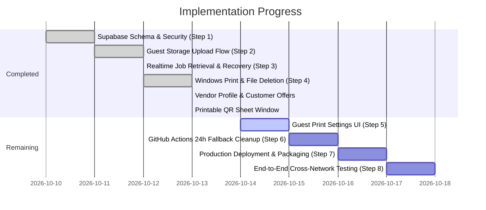

# Implementation Plan

## Phase Overview

The project is executed in small, independently verifiable phases. Steps 1 through 4 along with several UI and printing milestones have been implemented in code.

---

## Step 1 — Supabase Schema and Security [Completed]

- [x] Create `vendor_profiles` with unique slug, display name, and accepting toggle.
- [x] Create `print_jobs` table with status constraints and expiration timestamp.
- [x] Configure private `print-jobs` Storage bucket (25 MB limit, PDF/JPG/PNG).
- [x] Implement Row Level Security policies for vendors and storage objects.
- [x] Create security definer RPCs: `reserve_guest_print_job` and `complete_guest_print_job`.

*Verification:* Applied via `202610120001_storage_jobs.sql` and `202610120002_vendor_profile_select_grants.sql`.

---

## Step 2 — Guest Upload & Station Page [Completed]

- [x] Permanent URL resolution `/v/<slug>`.
- [x] Vendor availability check (`accepting_jobs = true`).
- [x] File type and size validation on the client.
- [x] Reserve job via RPC, upload directly to private Storage, and complete job via RPC.
- [x] Marketing landing page for root traffic at `/`.

*Verification:* Verified in `guest/src/components/upload/UploadPage.tsx` and `guest/src/guest.tsx`.

---

## Step 3 — Vendor Job Retrieval & Notifications [Completed]

- [x] Subscribe to Supabase Realtime `postgres_changes` on `print_jobs`.
- [x] Automatically recover and reconcile pending jobs on boot and reconnect.
- [x] 60-second fallback polling active only while Realtime is disconnected.
- [x] In-memory object URL generation for document previews in the dashboard.

*Verification:* Implemented in `vendor-desktop/src/lib/vendorJobs.ts`.

---

## Step 4 — Printing Integration & Immediate Cleanup [Completed]

- [x] High-fidelity PDF rendering via `pdfjs-dist` to canvas in offscreen window.
- [x] Normalization of print options (copies, duplex, orientation, paper size).
- [x] Immediate deletion of customer files from Supabase Storage upon print confirmation.
- [x] Deduplication of job events to prevent duplicate printing.
- [x] Built-in printable counter QR poster generator (`qr-print.html`).

*Verification:* Implemented in `vendor-desktop/electron/server.cjs` and `vendor-desktop/electron/pdf-print.html`.

---

## Step 5 — Guest Print Settings UI [Next]

- [ ] Add interactive print settings modal/drawer in `guest/` (copies, color/grayscale, duplex, orientation).
- [ ] Pass chosen settings into `reserve_guest_print_job` RPC (`p_print_settings`).
- [ ] Ensure settings pass validation and populate `print_jobs.print_settings`.

*Exit criteria:* Customer can specify 2 copies, black & white, and have those settings recorded in Postgres.

---

## Step 6 — 24-Hour Expiration Fallback Cleanup

- [ ] Create GitHub Actions workflow `.github/workflows/cleanup-expired-jobs.yml`.
- [ ] Implement cleanup script using Supabase management/service-role credentials.
- [ ] Query and remove files older than 24 hours from `print-jobs` Storage bucket and mark expired rows.
- [ ] Schedule workflow to run every 6 or 12 hours.

*Exit criteria:* Abandoned uploads older than 24 hours are removed automatically.

---

## Step 7 — Production Deployment & Windows Packaging

- [ ] Deploy `guest/` to Vercel with production environment variables (`VITE_SUPABASE_URL`, `VITE_SUPABASE_ANON_KEY`, `VITE_GUEST_BASE_URL`).
- [ ] Configure custom domain and SSL.
- [ ] Build and package the Windows desktop application with `npm run package`.
- [ ] Test installation of the generated NSIS `.exe` on a clean Windows machine.

*Exit criteria:* Guest site is live on HTTPS and desktop installer runs without errors.

---

## Step 8 — Cross-Network End-to-End Validation

- [ ] Test customer phone connected via cellular data (4G/5G).
- [ ] Submit PDF and image jobs to a vendor on an independent local network.
- [ ] Confirm silent printing on the physical printer.
- [ ] Confirm file is removed from Supabase Storage within seconds of print completion.
